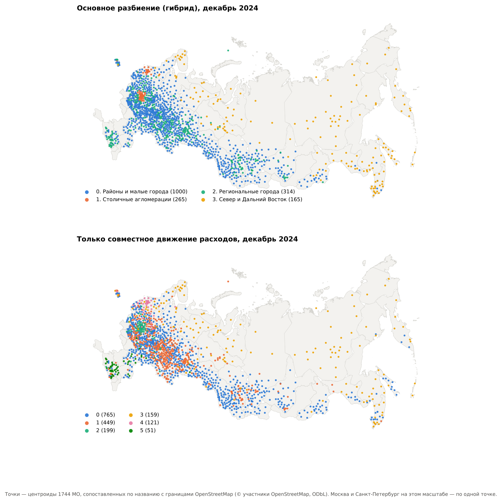

# Тратят похоже или тратят вместе

Динамическая сеть 1 904 муниципальных образований по безналичным потребительским расходам: типы локальных экономик, их устойчивость и изменение в 2024 году. Данные — СберИндекс, «Потребительские безналичные расходы на уровне муниципальных образований».

Автор — Равиль Ахтямов, Digital Economy Lab. Продолжение работы [«Шок по расписанию»](https://github.com/rav11l/sberindex-shocks) на той же выгрузке.

- Отчёт о методологии и результатах: [`report/methodology.md`](report/methodology.md)
- Рисунки: [`outputs/figures/`](outputs/figures/)

## Результаты в четырёх строках

1. **«Похожи» и «движутся вместе» — разные сети.** Разбиение по сходству уровня и структуры расходов и разбиение по совместному движению расходов согласуются на 0,16 (ARI).
2. **Сеть без координат сильно связана с географией.** 21 % рёбер совместного движения соединяют МО одного региона против 8 % у случайных пар МО одного типа; пять из шести кластеров читаются как макрорайоны — Москва, Санкт-Петербург с Северо-Западом, Север и Дальний Восток, Волго-Уральский пояс, Ставрополье.
3. **Четыре типа за год меняются мало.** Районы и малые города, столичные агломерации, региональные города, Север и Дальний Восток; за месяц тип меняют от 1,9 до 5,9 % МО в зависимости от режима, нетто-поток один — из районов в региональные города.
4. **Типы не помогают прогнозу.** Общий фактор типа даёт ошибку на 1,5–3,9 % больше, чем общий фактор страны: типы различаются уровнем, структурой и местом, а не ритмом.



## Быстрый старт

```bash
python -m venv .venv && source .venv/bin/activate      # Windows: .venv\Scripts\activate
pip install -r requirements.txt && pip install -e . --no-deps
python -m sclusters.cli data --download                # выгрузка с sberindex.ru + сверка sha256
python -m sclusters.cli all                            # все стадии и рисунки
pytest -q tests
```

Если выгрузка уже скачана для `sberindex-shocks`, достаточно положить `sberindex_mo_spending.parquet` в `data/raw/`: совпадение подтвердит контрольная сумма. Стадия `geo` сама клонирует границы OpenStreetMap в `data/external/` на закреплённом коммите; без доступа к GitHub она и карта пропускаются, остальное считается.

Любой параметр переопределяется без правки файла:

```bash
python -m sclusters.cli all --set cluster.resolution=0.75 graph.k=15
```

## Что внутри

| Путь | Содержимое |
|---|---|
| `configs/default.yaml` | все параметры: признаки, правила рёбер, методы, разрешение, устойчивость, проверка, названия типов |
| `src/sclusters/data.py` | загрузка, восстановление рядов, сборка куба МО × месяц × категория |
| `src/sclusters/features.py` | признаки узла (уровень, структура, прирост) и профиль совместного движения |
| `src/sclusters/graphs.py` | три правила рёбер: сходство, совместное движение, гибрид |
| `src/sclusters/cluster.py` | Leiden, спектральная, k-средних; метрики качества |
| `src/sclusters/dynamics.py` | сопоставление кластеров во времени, события, переходы |
| `src/sclusters/validate.py` | внешняя проверка через прогноз с плацебо-разбиениями |
| `src/sclusters/geo.py` | сопоставление МО с границами OpenStreetMap — только для проверки и карты |
| `src/sclusters/pipeline.py` | стадии `data → snapshots → compare → stability → validate → geo → dynamics → summary` |
| `outputs/` | таблицы и рисунки прогона; в git — только рисунки |

Сырые данные СберИндекса и геометрия OpenStreetMap в репозиторий не кладутся.

## Лицензия и цитирование

Код — MIT. Границы МО — © участники OpenStreetMap, ODbL, через [timurkanaz/Russia_geojson_OSM](https://github.com/timurkanaz/Russia_geojson_OSM). Данные — СберИндекс.

Ахтямов Р. Тратят похоже или тратят вместе: динамическая сеть муниципалитетов по безналичным расходам. Digital Economy Lab, 2026. github.com/rav11l/sberindex-clusters
